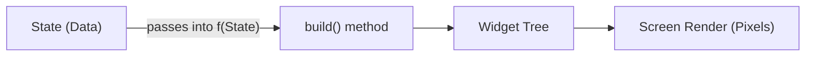
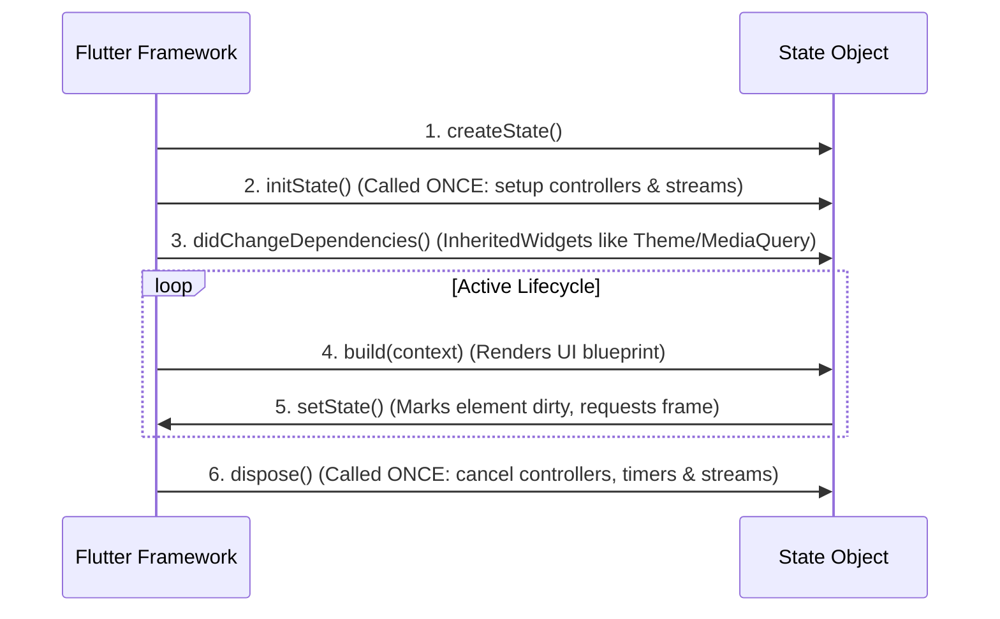
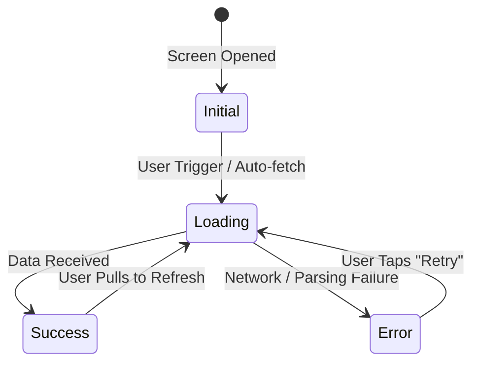
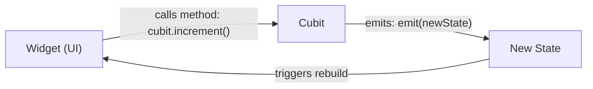
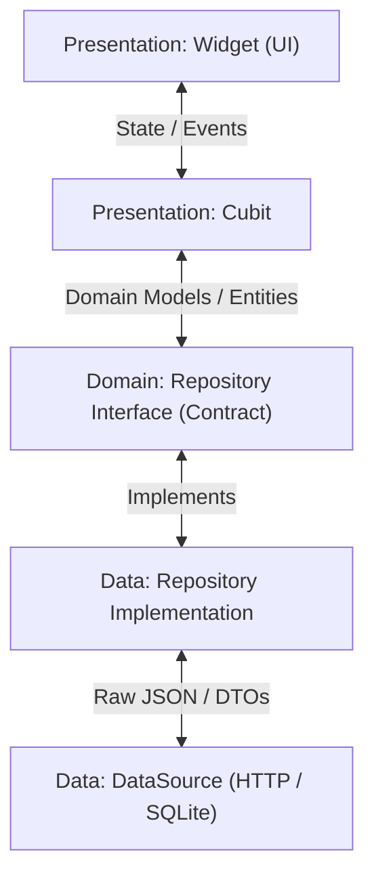

# 📘 Flutter Beginner's Complete Teaching Guide

A structured curriculum and reference handbook for teaching Flutter fundamentals from first principles to production architecture.

---

## Table of Contents
1. [Module 1: The Flutter Mental Model](#module-1-the-flutter-mental-model)
2. [Module 2: Essential UI Components Catalog](#module-2-essential-ui-components-catalog)
3. [Module 3: StatelessWidget vs StatefulWidget (`stless` vs `stful`)](#module-3-statelesswidget-vs-statefulwidget-stless-vs-stful)
4. [Module 4: State Architecture & The 4 Canonical States](#module-4-state-architecture--the-4-canonical-states)
5. [Module 5: Cubit State Management (`flutter_bloc`)](#module-5-cubit-state-management-flutter_bloc)
6. [Module 6: The Repository Pattern & Clean Architecture](#module-6-the-repository-pattern--clean-architecture)
7. [Module 7: Top 10 Beginner Pitfalls & How to Avoid Them](#module-7-top-10-beginner-pitfalls--how-to-avoid-them)
8. [Module 8: Practice Coding Challenges](#module-8-practice-coding-challenges)

---

## Module 1: The Flutter Mental Model

### 1.1 Declarative vs. Imperative UI
In traditional native development (Android XML, iOS UIKit, or vanilla HTML/DOM), UI programming is **imperative**:
```
// Imperative (Old way): You find the view and mutate its properties manually
button.setColor(Colors.BLUE);
button.setText("Clicked!");
```
In Flutter, the UI is **declarative**:
$$\mathbf{UI = f(State)}$$
You never mutate existing widgets on screen. Instead:
1. You define a function `build()` that returns what the UI looks like for a given **State**.
2. When the state changes, Flutter calls `build()` again and replaces the widget blueprint.
3. The Flutter rendering engine diffs the changes and updates only the necessary pixels on the screen at 60 or 120 FPS.



### 1.2 "Everything is a Widget"
In Flutter, widgets are not just UI buttons or text; layout, padding, gesture detection, and theming are also widgets:
- Structural elements: `Scaffold`, `AppBar`, `Drawer`
- Layout elements: `Row`, `Column`, `Stack`, `Padding`, `Center`
- Styling elements: `Theme`, `Container`, `DecoratedBox`
- Interactive elements: `GestureDetector`, `InkWell`

### 1.3 The 3 Trees of Flutter
When teaching beginners, clarify that Flutter maintains 3 parallel trees:
1. **Widget Tree**: Lightweight, immutable configurations created frequently (cheap to destroy).
2. **Element Tree**: The runtime manager/controller connecting widgets to render objects (persists across rebuilds).
3. **RenderObject Tree**: The low-level tree that handles layout constraints, painting pixels, and hit testing.

---

## Module 2: Essential UI Components Catalog

### 2.1 Layout & Structure

| Widget | Purpose | Key Properties | Beginner Tip |
| :--- | :--- | :--- | :--- |
| `Row` | Arranges children horizontally | `mainAxisAlignment`, `crossAxisAlignment` | Wrap flex children in `Expanded` or `Flexible` to prevent `RenderFlex overflow`. |
| `Column` | Arranges children vertically | `mainAxisAlignment`, `crossAxisAlignment` | Never place an unbounded `ListView` inside a `Column` without wrapping it in `Expanded`. |
| `Stack` | Overlays children in 3D depth (Z-axis) | `alignment`, `children` | Children render back-to-front. Use `Positioned` to pin coordinates (`top: 8`, `right: 8`). |
| `Wrap` | Flow layout wrapping onto new lines | `spacing`, `runSpacing` | Use instead of `Row` when items (like chips/tags) exceed screen width. |
| `Container` | Multi-purpose styling box | `decoration`, `padding`, `margin` | If you only need sizing or padding, use `SizedBox` or `Padding` for better rendering performance. |
| `SizedBox` | Fixed width/height or empty spacer | `width`, `height`, `child` | Prefer `const SizedBox(height: 16)` over empty Containers for layout spacing. |
| `Expanded` | Expands child to fill remaining flex space | `flex: 1` | Only valid inside a `Row`, `Column`, or `Flex`. |

#### The Golden Box Rule:
> *"Constraints go down. Sizes go up. Parent sets position."*

---

### 2.2 Buttons & User Input

#### Button Hierarchy:
1. **Primary Action**: `ElevatedButton` — Solid surface with elevation. Used for the single primary call-to-action on a screen.
2. **Secondary Action**: `OutlinedButton` — Transparent body with border. Used for secondary, reversible actions (e.g., "Cancel", "Back").
3. **Subtle Action**: `TextButton` — Borderless, flat text. Used inside dialogs, card footers, or inline actions.
4. **Tool Action**: `IconButton` / `FloatingActionButton` — Dedicated icon triggers.

#### Form Inputs:
- **`TextField`**: Standalone input for basic search bars or message boxes.
- **`TextFormField`**: Wrapped input designed for `Form`. Provides built-in `validator: (value) => ...` logic triggered via `_formKey.currentState!.validate()`.
- **`SwitchListTile`**: Instant boolean toggle (e.g., Dark Mode, Notifications).
- **`CheckboxListTile`**: Multi-select toggle (e.g., Terms of Service).
- **`RadioGroup` / `Radio`**: Mutual exclusivity (single choice among several options).
- **`Slider`**: Continuous or stepped numeric ranges (e.g., volume, distance).
- **`DropdownButtonFormField`**: Compact single-selection menu.

---

### 2.3 Display & Feedback Components

- **`RichText` & `TextSpan`**: Allows mixed styling (bold, color, links) in a single sentence:
  ```dart
  RichText(
    text: TextSpan(
      style: TextStyle(color: Colors.black87),
      children: [
        TextSpan(text: 'Already have an account? '),
        TextSpan(
          text: 'Log In',
          style: TextStyle(color: Colors.blue, fontWeight: FontWeight.bold),
        ),
      ],
    ),
  );
  ```
- **`Card`**: Surface container with standardized elevation, theme-aware background, and rounded corners.
- **`Image.network`**: Always include `errorBuilder` and `loadingBuilder` to prevent crashes when offline or loading:
  ```dart
  Image.network(
    url,
    errorBuilder: (context, error, stackTrace) => const Icon(Icons.broken_image),
    loadingBuilder: (context, child, progress) =>
        progress == null ? child : const CircularProgressIndicator(),
  );
  ```
- **`ListView.builder`**: Recycles viewport memory (lazy loading). Never use `Column` inside a `SingleChildScrollView` for unbounded or large lists!
- **`Dismissible`**: Adds swipe-to-delete gesture with background animation.
- **`AlertDialog` & `showModalBottomSheet`**: Modals for user decisions and supplementary flows.

---

## Module 3: StatelessWidget vs StatefulWidget (`stless` vs `stful`)

### 3.1 The Fundamental Distinction

| Characteristic | `StatelessWidget` | `StatefulWidget` |
| :--- | :--- | :--- |
| **Dart Class Structure** | Single class | Two classes: `StatefulWidget` + `State<T>` |
| **Mutability** | 100% Immutable (`final` fields only) | Widget is immutable; `State` is mutable |
| **Lifecycle Methods** | `build()` only | `createState()`, `initState()`, `build()`, `dispose()`, etc. |
| **Rebuild Mechanism** | Rebuilt only when parent passes new props | Rebuilt via `setState()` or when parent updates |
| **Primary Use Cases** | Dumb presentation views, pure UI, BLoC/Cubit UI | Controllers (Text, Scroll, Animation), ephemeral UI |

---

### 3.2 What Happens Under the Hood?

#### The Stateless Attempt (Why it fails):
```dart
class BrokenCounter extends StatelessWidget {
  int count = 0; // ⚠️ Modifying this variable does NOT trigger a redraw!

  @override
  Widget build(BuildContext context) {
    return ElevatedButton(
      onPressed: () {
        count++; // Variable is now 1 in memory, but Flutter Element was never notified!
      },
      child: Text('$count'),
    );
  }
}
```

#### The Stateful Solution:
```dart
class WorkingCounter extends StatefulWidget {
  const WorkingCounter({super.key});

  @override
  State<WorkingCounter> createState() => _WorkingCounterState();
}

class _WorkingCounterState extends State<WorkingCounter> {
  int _count = 0;

  @override
  Widget build(BuildContext context) {
    return ElevatedButton(
      onPressed: () {
        setState(() {
          _count++; // 1. Updates variable
                    // 2. Marks this State's Element as DIRTY
                    // 3. Schedules the next frame build()
        });
      },
      child: Text('$_count'),
    );
  }
}
```

---

### 3.3 The `State` Lifecycle Timeline



#### Lifecycle Rules:
1. **Never** call `setState()` inside `initState()` or `dispose()`.
2. **Always** clean up `TextEditingController`, `AnimationController`, and `StreamSubscription` inside `dispose()`.

---

## Module 4: State Architecture & The 4 Canonical States

### 4.1 Ephemeral State vs. App State

- **Ephemeral (Local) State**: State contained within a single widget (e.g., current tab in a `BottomNavigationBar`, text in a search input, animation ticker).
  - *Tool*: `StatefulWidget` with `setState()`.
- **App State (Global/Shared)**: State needed across multiple screens or throughout the entire application (e.g., logged-in User profile, Shopping cart, Theme mode, API data).
  - *Tool*: `Cubit` / `Bloc` with a clean Repository.

---

### 4.2 The 4 Canonical UI States
Every asynchronous screen in a production app transitions between these 4 states:



1. **`Initial`**: Idle. Awaiting user interaction (e.g., empty search query).
2. **`Loading`**: Async operation in-flight. Display spinners or skeleton shimmers.
3. **`Success` / `Loaded`**: Data ready. Render list, cards, or metrics.
4. **`Error`**: Operation failed. Render human-readable error message with a **Retry** button.

---

### 4.3 Why Immutability & Equatable?
Dart compares custom objects by **memory reference** by default:
```dart
class RegularState {
  final int count;
  RegularState(this.count);
}

final a = RegularState(1);
final b = RegularState(1);
print(a == b); // ❌ FALSE! Different memory addresses.
```
By extending **`Equatable`**, Dart compares the contents of `props`:
```dart
class EquatableState extends Equatable {
  final int count;
  const EquatableState(this.count);

  @override
  List<Object?> get props => [count];
}

final x = EquatableState(1);
final y = EquatableState(1);
print(x == y); // ✅ TRUE! Same values in props.
```
> **Why this matters for BLoC/Cubit**: BLoC checks `if (newState == oldState)` before rebuilding the UI. With `Equatable`, if a Cubit emits state identical to the current state, Flutter automatically skips redundant widget repaints.

---

## Module 5: Cubit State Management (`flutter_bloc`)

### 5.1 What is Cubit?
`Cubit` is a lightweight, simplified variant of `BLoC`:
- **BLoC**: UI ➔ Dispatches Event Object ➔ Event Handler ➔ Emits State.
- **Cubit**: UI ➔ Calls Method Directly ➔ Emits State.

Cubit eliminates event classes and boilerplate while preserving all benefits of predictable unidirectional state management.



---

### 5.2 The 3 Core BLoC Consumers

#### 1. `BlocBuilder` (Pure UI Rendering)
Rebuilds a widget subtree whenever the state changes.
```dart
BlocBuilder<CounterCubit, CounterState>(
  builder: (context, state) {
    return Text('Count: ${state.count}');
  },
)
```

#### 2. `BlocListener` (Side-Effects Only)
Executes non-rendering actions (SnackBars, navigation, dialogs) exactly once per state transition.
```dart
BlocListener<CounterCubit, CounterState>(
  listener: (context, state) {
    if (state.count == 10) {
      ScaffoldMessenger.of(context).showSnackBar(
        SnackBar(content: Text('Target reached!')),
      );
    }
  },
  child: const MyWidget(),
)
```

#### 3. `BlocConsumer` (Builder + Listener Combined)
Combines `builder` and `listener` in a single widget to avoid nested trees.
```dart
BlocConsumer<CounterCubit, CounterState>(
  listener: (context, state) {
    if (state.isMilestone) showCelebration();
  },
  builder: (context, state) {
    return CounterDisplay(state.count);
  },
)
```

---

### 5.3 The Golden Rule: `context.read` vs. `context.watch`

```dart
// ✅ RULE 1: Inside callbacks (onPressed, onTap) ALWAYS use context.read:
ElevatedButton(
  onPressed: () => context.read<CounterCubit>().increment(),
  child: const Text('Increment'),
);

// ❌ RULE 2: NEVER use context.watch inside large build methods without scoping!
Widget build(BuildContext context) {
  // If count changes, THIS ENTIRE BUILD METHOD RUNS AGAIN!
  final count = context.watch<CounterCubit>().state.count;
  return Column(children: [ HeavyWidget1(), HeavyWidget2(), Text('$count') ]);
}

// 💡 RULE 3: Use BlocBuilder or context.select for scoped rebuilds:
final count = context.select<CounterCubit, int>((c) => c.state.count);
```

---

## Module 6: The Repository Pattern & Clean Architecture

### 6.1 Clean Architecture Flow



### 6.2 Why Use a Repository Interface?
1. **Decoupling**: The Cubit depends on the abstract contract `UserRepository`, NOT on Dio, HTTP, or Firebase.
2. **Testability**: In unit tests, you can mock `UserRepository` with zero network dependencies.
3. **Data Source Swapping**: If you switch from REST to GraphQL or SQLite, only the Data layer changes — zero lines of UI or Cubit code are modified.

---

### 6.3 Anatomy of a Clean Repository Flow

#### Step 1: Model
```dart
class UserProfile extends Equatable {
  final String id;
  final String name;
  final String email;

  const UserProfile({required this.id, required this.name, required this.email});

  factory UserProfile.fromJson(Map<String, dynamic> json) => UserProfile(
    id: json['id'],
    name: json['name'],
    email: json['email'],
  );

  @override
  List<Object?> get props => [id, name, email];
}
```

#### Step 2: Repository Contract (Domain)
```dart
abstract class UserRepository {
  Future<List<UserProfile>> getUsers();
}
```

#### Step 3: Repository Implementation (Data)
```dart
class UserRepositoryImpl implements UserRepository {
  final UserRemoteDataSource dataSource;

  UserRepositoryImpl({required this.dataSource});

  @override
  Future<List<UserProfile>> getUsers() async {
    try {
      final rawList = await dataSource.fetchRawUsers();
      return rawList.map((j) => UserProfile.fromJson(j)).toList();
    } catch (e) {
      throw UserOperationException('Failed to load users: $e');
    }
  }
}
```

#### Step 4: Cubit (Business Logic)
```dart
class UserDirectoryCubit extends Cubit<UserDirectoryState> {
  final UserRepository repository;

  UserDirectoryCubit({required this.repository}) : super(const UserDirectoryInitial());

  Future<void> loadUsers() async {
    emit(const UserDirectoryLoading());
    try {
      final users = await repository.getUsers();
      emit(UserDirectoryLoaded(users: users));
    } catch (e) {
      emit(UserDirectoryError(message: e.toString()));
    }
  }
}
```

---

## Module 7: Top 10 Beginner Pitfalls & How to Avoid Them

1. **Yellow-and-Black Striped Overflow (`RenderFlex overflowed`)**:
   - *Cause*: Placing children inside a `Row` or `Column` whose total size exceeds available screen space.
   - *Fix*: Wrap flex children in `Expanded` or `Flexible`, or replace `Row` with `Wrap`.

2. **Calling `setState()` in `build()`**:
   - *Cause*: Causes infinite build recursion and crashes the app.
   - *Fix*: Keep `build()` pure and synchronous. Trigger state changes only from user event callbacks or stream listeners.

3. **Forgetting to dispose Controllers**:
   - *Cause*: Memory leaks from orphaned `TextEditingController`, `AnimationController`, or `FocusNode`.
   - *Fix*: Always call `.dispose()` inside the `State.dispose()` method.

4. **Navigating or Showing SnackBars inside `build()`**:
   - *Cause*: Modifying the navigator/overlay while the current frame is still actively laying out.
   - *Fix*: Use `BlocListener` or `WidgetsBinding.instance.addPostFrameCallback`.

5. **`SingleChildScrollView` + `Column` for large lists**:
   - *Cause*: All 1,000 items are rendered into memory simultaneously, causing dropped frames (jank).
   - *Fix*: Use `ListView.builder` for viewport recycling.

6. **Not adding `const` to Constructors**:
   - *Cause*: Recreates identical widget instances on every parent build frame.
   - *Fix*: Add `const` to all static widgets. Flutter will reuse the exact same memory instance across frames.

7. **Mutating State objects in place**:
   - *Cause*: `state.items.add(newItem); emit(state);` — the state instance reference is unchanged, so BLoC skips the rebuild!
   - *Fix*: Always emit a new instance using `copyWith` or new object creation.

8. **Hardcoding Strings and Colors**:
   - *Cause*: Breaks Dark Mode parity and internationalization.
   - *Fix*: Use `Theme.of(context).colorScheme` and semantic design tokens.

9. **Blocking the UI thread with synchronous calculations**:
   - *Cause*: Heavy loops or JSON parsing on the main isolate freeze the 60fps frame cycle.
   - *Fix*: Offload heavy computations using `compute(function, message)`.

10. **Placing unbounded widgets inside unbounded parents**:
    - *Cause*: `Column` (unbounded height) inside another `Column` with `ListView` without height constraints.
    - *Fix*: Wrap the inner scrollable with `Expanded` or `SizedBox(height: ...)`.

---

## Module 8: Practice Coding Challenges

### Challenge 1: The Toggle Switch
- **Objective**: Create a `StatefulWidget` containing a light bulb icon that turns from grey to yellow when tapped, updating a text label below it ("Light is ON" / "Light is OFF").
- **Core Concept**: `setState()` and local ephemeral state.

### Challenge 2: Search Filter with Cubit
- **Objective**: Build a `SearchCubit` with states `SearchInitial`, `SearchLoading`, `SearchLoaded(List<String>)`. As the user types in a `TextField`, filter a list of 10 items with a 300ms simulated delay.
- **Core Concept**: Cubit functions, state emission, and `BlocBuilder`.

### Challenge 3: Repository Pattern with Retry
- **Objective**: Create an `AuthRepository` with a method `Future<bool> login(email, password)`. Implement a mock that fails 50% of the time, and build a UI screen with a "Retry" button when `AuthError` state is emitted.
- **Core Concept**: Exception mapping, clean architecture flow, and the 4 canonical states.
